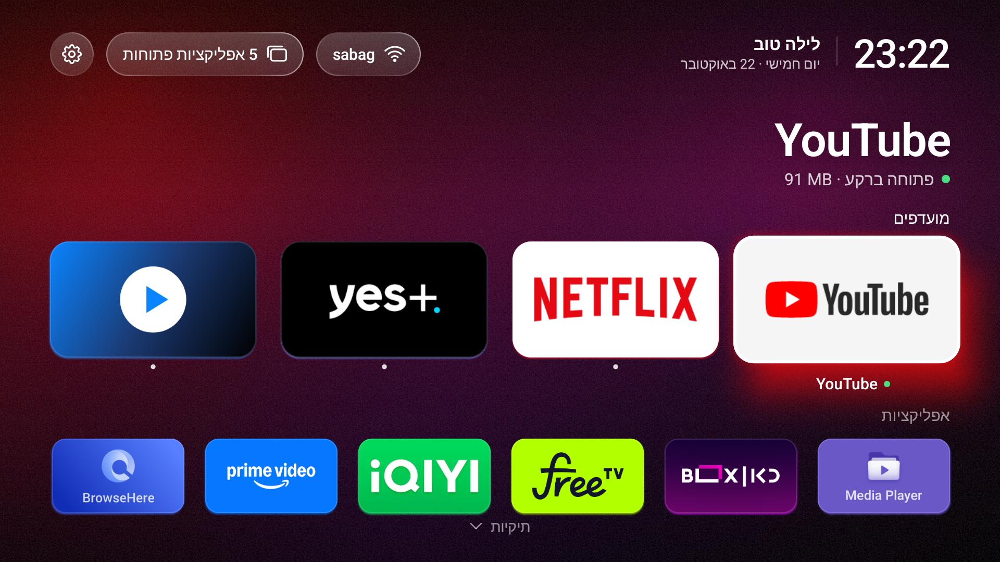
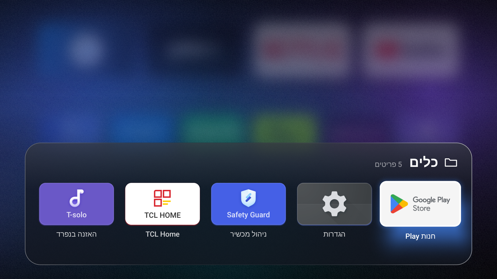
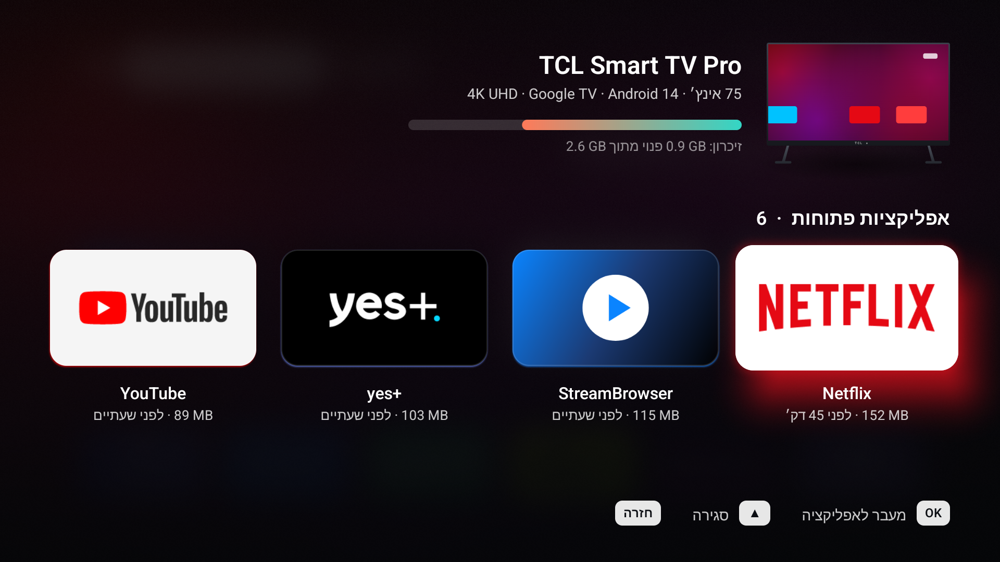
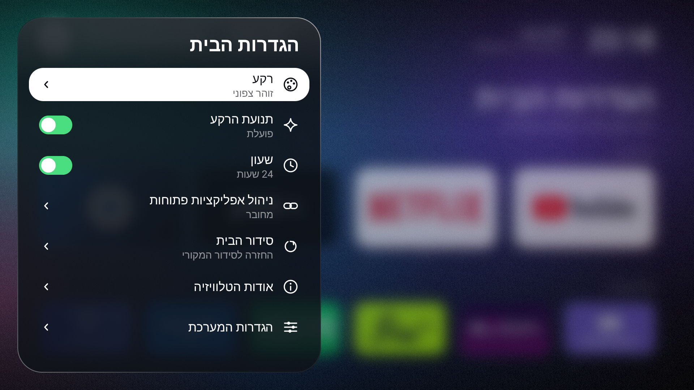

# Aura

**A liquid-glass home screen for Android TV / Google TV**, built to replace a slow stock launcher on a TCL Google TV 14 and a Xiaomi Mi TV 4S (Android 11). Hebrew-first (RTL), remote-only navigation, and fast on weak TV GPUs.



| | |
|---|---|
|  |  |
|  | |

## What it does

- **Home rows**: favorites, all apps and TV inputs (HDMI, antenna) as cards; folders (tools, not in use, inputs) that open as a glass panel.
- **Open apps, like a phone's recents**: the TV's memory on top and the open apps as large cards. ▲ closes an app, OK switches to it, and the last card closes them all. A memory chip in the top bar frees memory in one press.
- **Remote buttons**: map the remote's spare buttons to apps from Settings. An accessibility service sees keys only, never screen content; navigation, Back, Home, volume and power are never taken over.
- **Backgrounds**: a living light field tinted by the focused app's colors, or photo collections prepared on the PC and copied to the TV.
- **Liquid glass**: every surface shows the background behind it, frosted and brighter, with a specular rim; on newer TVs the rim bends it like a lens.
- **Full and lite modes**: lite switches itself on for weaker TVs (older Android or less memory).

## How it's built

Plain Java and the Android SDK's command-line tools: no Gradle, no libraries.

| | |
|---|---|
| UI | Custom `View`s on a 960×540 dp canvas: cards with spring focus, rows that keep focus inside the TV's safe area, glass sheets for menus, folders, open apps and settings |
| Rendering on weak GPUs | The TCL's GPU drops to 7–15 fps on any full-screen gradient, so the light field is computed per pixel at 384×216 (a smooth falloff per light) and scaled up; glass reads one small blurred backdrop bitmap, and shaders are rebuilt only on resize |
| Open apps | Android 14 gives apps no way to see or stop other apps, so `Adb.java` is a minimal adb client to the TV's own adbd (127.0.0.1:5555): `dumpsys activity` for windows that are really open, `am force-stop` to close |
| Privacy | The network chip is passive (no scans, no external hosts); the accessibility service reads keys only |

```
src/com/sabag/aura/   HomeActivity (layout, focus, actions) and the views, sheets, glass and ambient renderer
res/, assets/fonts/   manifest resources and the Rubik font
build.ps1             aapt2 → javac → d8 → zipalign → apksigner
tools/make-art.ps1    generates the app icon and the TV banner
tv/                   PowerShell helpers: install, wallpapers, and reversible debloat scripts for the two TVs
```

## Build and install

Needs the Android SDK (build-tools 36.1.0, platform 35) and JDK 21.

```powershell
.\build.ps1 -VersionCode 21 -VersionName 1.6.1
```

The APK is signed with the Android debug key unless you create `signing.local.ps1` (see `signing.example.ps1`).

To install on a TV, turn on network debugging on it, then:

```powershell
Copy-Item tv\devices.example.ps1 tv\devices.local.ps1   # put your TV's serial and IP in it
.\tv\install.ps1                                        # installs, grants the optional permissions, sets Aura as home
.\tv\wallpapers.ps1 -Source C:\Pictures\Landscapes -Apply
```

The debloat scripts (`tv\debloat.ps1` for the TCL, `tv\xiaomi-debloat.ps1` for the Mi TV 4S) only disable packages, write an undo log, and are safe to run again. Their package lists are specific to those two TVs: read them before running on another model.

## License

[MIT](LICENSE) © 2026 Hananel Sabag
